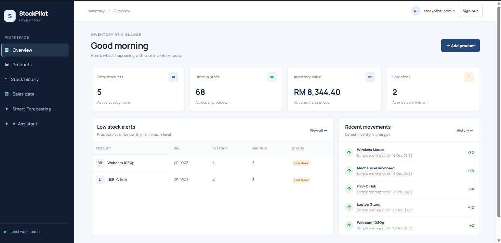
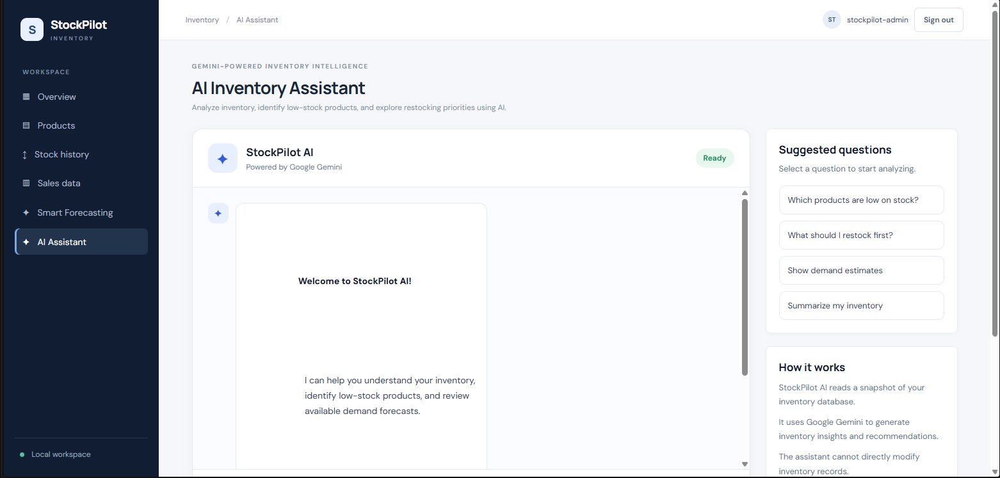
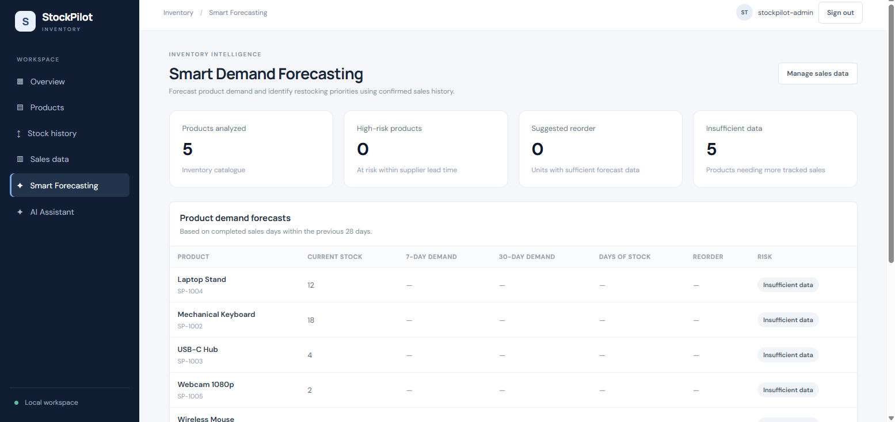

# StockPilot AI

### AI-Powered Inventory Management & Smart Demand Forecasting

StockPilot AI is a Python-based inventory management application that integrates **Google Gemini** to provide intelligent inventory analysis and natural-language recommendations.

The project demonstrates how a generative AI model can be integrated into a database-backed business application while keeping quantitative calculations deterministic and verifiable.

## Core Capabilities

**1. Gemini AI Inventory Assistant**

Users can ask questions about inventory levels, products requiring attention and restocking priorities. The application constructs a structured inventory snapshot and provides it to the Gemini API for natural-language analysis.

**2. Smart Demand Forecasting**

The forecasting module calculates average daily demand from explicitly tracked sales days within a 28-day lookback window. At least seven complete tracking days are required before producing a forecast.

**3. Restocking Recommendations**

The application calculates estimated demand, stock coverage and suggested reorder quantities using lead-time and safety-stock arguments in Python (currently seven days each; no configuration UI).

**4. Inventory and Sales Management**

Users can manage products, record sales, track stock movements and review historical sales data.

**5. Authentication and Automated Testing**

The application includes administrator authentication, CSRF protection, database migrations and automated tests.

## Technical Architecture

```text
User / Web Interface
        |
        v
FastAPI Application
        |
        +---- Inventory & Sales Services
        |           |
        |           v
        |     SQLAlchemy / SQLite
        |
        +---- Demand Forecasting
        |           |
        |           v
        |     Python Calculations
        |
        +---- AI Inventory Assistant
                    |
                    v
             Inventory Snapshot
                    |
                    v
             Google Gemini API
                    |
                    v
           Natural-Language Answer
```

## Verification

Latest Phase 5.1.1 verification: **130 passed, 1 warning** (71 Phase 5.1 baseline cases plus 59 provider-resilience cases). The remaining warning is the existing Starlette/httpx deprecation warning. Run the full suite using the command below to verify your environment.

The automated tests cover inventory workflows, sales tracking, forecasting and AI assistant integration. Mocked AI tests verify application behavior independently of live Gemini API availability.

## Application Screenshots

### Inventory Dashboard


### Gemini AI Assistant


### Smart Demand Forecasting


## Installation, Configuration and Technical Documentation

The sections below document the project's setup, database migrations, security controls and implementation history.

## Requirements

- Python 3.13
- PowerShell (commands below assume the repository is `C:\Users\User\ai-engineering` and its virtual environment is `.venv`)

## Install

From the repository root:

```powershell
.\.venv\Scripts\Activate.ps1
python --version
python -m pip install -r .\projects\stockpilot-ai\requirements.txt
```

Use the repository-root environment at `C:\Users\User\ai-engineering\.venv`, not the separate `.venv` inside the project. Activation is optional; from the repository root you can install directly with:

```powershell
.\.venv\Scripts\python.exe -m pip install -r .\projects\stockpilot-ai\requirements.txt
```

No upgrade flag is required. The added dependencies are pinned to the versions verified in this environment: `google-genai==2.34.0` and `python-dotenv==1.2.4`. Existing dependency ranges are unchanged; no ML libraries are required.

## Configure and initialize

All entry points load `projects/stockpilot-ai/.env` through `app.config`, independently of the working directory. Existing process environment variables take precedence over `.env`, including explicitly empty values. Defaults apply only when a variable is absent. Configuration is loaded at process startup; restart after editing `.env`.

For a new installation only, copy `.env.example` to `.env` if no `.env` exists. Never overwrite an existing configuration. Set a private, securely generated `STOCKPILOT_SECRET_KEY` of at least 32 characters; the example intentionally leaves it empty. Keep that key stable across restarts. Set `STOCKPILOT_COOKIE_SECURE=false` only for local HTTP; production defaults to secure cookies and requires HTTPS.

| Variable | Requirement / default |
|---|---|
| `DATABASE_URL` | Optional; `sqlite:///./stockpilot.db` |
| `STOCKPILOT_SECRET_KEY` | Required for the web app; no default |
| `STOCKPILOT_COOKIE_SECURE` | Optional; `true` |
| `GEMINI_API_KEY` | Required only for AI answers; no default |
| `GEMINI_MODEL` | Optional; `gemini-3.1-flash-lite` |

Default and relative SQLite file paths now resolve against the **StockPilot project directory**, consistently for the web app, backups and Alembic. Absolute database URLs remain unchanged. In-memory URLs and explicit SQLite URI filenames retain their semantics.

**Compatibility:** if you previously launched from another directory with a relative database URL, set an explicit absolute `DATABASE_URL` pointing to your existing database before running any write command. This milestone does not move or modify that database.

After configuring a new installation, initialize it explicitly. For an existing database, follow the backup procedure below before upgrading:

```powershell
Set-Location C:\Users\User\ai-engineering\projects\stockpilot-ai
$env:DATABASE_URL = "sqlite:///./stockpilot.db"
..\..\.venv\Scripts\python.exe -m app.init_db
```

The database is initialized explicitly and is never seeded on startup. To add example products and their opening inventory movements, run:

```powershell
..\..\.venv\Scripts\python.exe -m app.seed
```

The seed command runs migrations and adds the sample catalog only when the database has no products. Use it only when you want sample products; it does not generate sales history.

## Run

```powershell
Set-Location C:\Users\User\ai-engineering\projects\stockpilot-ai
..\..\.venv\Scripts\python.exe -m uvicorn app.main:app --reload
```

Create an administrator using `..\..\.venv\Scripts\python.exe -m app.create_admin` after initialization, then open <http://127.0.0.1:8000>. The command prompts for credentials without echoing the password; no default account exists.

From the repository root, the web app can also be launched with:

```powershell
.\.venv\Scripts\python.exe -m uvicorn app.main:app --app-dir .\projects\stockpilot-ai --reload
```

Configuration is independent of working directory; Python still needs the project on its import path. Run `python -m app.<utility>` from the project directory, or provide that directory through `PYTHONPATH` when invoking utilities elsewhere.

## Gemini configuration

Provide your Gemini API key through `GEMINI_API_KEY` in the hosting environment or the project `.env`. The model remains `gemini-3.1-flash-lite`. Never put keys in source control or shell examples. Inventory pages and deterministic forecasting work without an API key; AI chat returns a safe configuration message if the key is missing.

The assistant sends a snapshot of up to 50 products and the user question to Google Gemini. Python computes all demand and reorder quantities; Gemini explains those supplied results. Model availability and account permissions are not verified by the offline tests.

### Phase 5.1.1: AI provider resilience

The same centralized configuration supplies these optional settings. Process environment variables override the project `.env`; restart the application after changing configuration. This milestone does not modify your existing `.env`.

| Variable | Default | Accepted values |
|---|---|---|
| `GEMINI_REQUEST_TIMEOUT_SECONDS` | `30` | Finite number from 0.1 to 300 seconds |
| `GEMINI_TOTAL_BUDGET_SECONDS` | `60` | Finite number from 0.1 to 600 seconds |
| `GEMINI_MAX_ATTEMPTS` | `2` | `1` or `2`, including the initial attempt |

The installed `google-genai==2.34.0` SDK uses **milliseconds** for `HttpOptions.timeout`; application seconds are converted to milliseconds. Each attempt uses the smaller of its configured timeout and the remaining total budget. Async cancellation bounds provider I/O and retry waits together, including a stalled provider call. The public service remains synchronous for the existing FastAPI worker-thread handler. Local client setup is checked against the budget before sending; synchronous setup cannot be preempted by async cancellation. Resource cleanup has a separate allowance of up to one second for async close, followed by local synchronous close. Snapshot building and prompt preparation are outside this provider budget.

Only HTTP 500, 502, 503, 504, request timeouts (including 408), and transient network failures are retried. The delay uses exponential backoff with jitter: 0.25–0.5 seconds before the second attempt. SDK retries are explicitly limited to one attempt so application retries do not multiply SDK retries.

HTTP 429 is handled separately: retry only when a valid `Retry-After` seconds value or HTTP date is supplied and the wait fits the remaining budget. The wait is at least the larger of that value and the jittered backoff; a past date means no additional provider-mandated delay. Missing/invalid headers or waits exceeding the budget return the rate-limit message immediately. Authentication, invalid requests, initialization failures, empty answers and unexpected errors are not retried. **A retry can cause additional billable API usage**, even if the first request timed out after reaching the provider. This is a read-only explanation request; no inventory action is retried.

| Failure | Application HTTP status | Safe user message |
|---|---|---|
| Deadline/timeout | 504 | The AI request timed out. Please try again. |
| Rate limit | 429 | The AI service is rate-limited. Please try again later. |
| Provider authentication (401/403) | 502 | The AI service could not authenticate. Please contact the administrator. |
| Other provider 4xx | 502 | The AI service could not process this request. Please try a different question. |
| Missing/invalid local configuration | 503 | The AI service is not configured correctly. Please contact the administrator. |
| Provider service/empty answer/unexpected failure | 503 | The Gemini service is currently unavailable. |

Local question validation still returns 422. Authentication and CSRF requirements are unchanged. Existing chat JavaScript displays the safe `detail` as text and clears its loading state in `finally` on both success and failure.

The standard Python logger `app.ai_provider` records allowlisted error category, numeric upstream HTTP status (when available), sanitized model identifier, elapsed seconds, attempt number and lifecycle stage. Failures use WARNING, successes use INFO (enable INFO for this logger in your deployment logging configuration). These fields are included in the formatted message and attached to the log record for structured handlers. No raw provider messages, payloads, exception tracebacks, keys, prompts or inventory snapshots are logged by this boundary. Client initialization uses attempt zero. The browser receives allowlisted messages only, even if an internal exception contains sensitive text.

Tests mock all Gemini traffic and retry waits, exercise cancellation with a stalled async mock, and verify the installed SDK using in-memory HTTP transports. Run the complete suite with the repository-root virtual environment as shown below. For manual verification, start the local app and check sign-in/AI page rendering without submitting chat. An authenticated chat submission calls the live provider and may incur usage; perform that separately only when intended. Check WARNING logs for sanitized status/category/attempt fields if a failure occurs. No successful live generation or provider recovery is claimed by the offline suite.

## Test

From the project folder:

```powershell
..\..\.venv\Scripts\python.exe -m pytest
```

The tests use a temporary SQLite database and cover product creation, duplicate SKU rejection, stock adjustment validation and history, low-stock calculations, and persistence across database sessions.

## Milestone 2A: Sales history

Sales are recorded separately from manual stock corrections and supplier receipts. Each sale stores the product, quantity, sale date, unit selling price snapshot, and creation timestamp. Recording a sale reduces stock and writes a sale-specific inventory movement in the same database transaction. If any part fails, all changes roll back.

After updating an existing installation, initialize the database from the project directory to create the new sales tables:

```powershell
Set-Location C:\Users\User\ai-engineering\projects\stockpilot-ai
..\..\.venv\Scripts\python.exe -m app.init_db
```

The current `app.init_db` command runs Alembic upgrades, not a standalone `create_all` initialization. Back up existing databases before applying upgrades as described below. No sales demo data is generated. The existing `app.seed` command adds sample products only when the catalog is empty; it does not create sales records.

Open <http://127.0.0.1:8000/sales> to enter sales and review daily summaries. Each product/date must be explicitly marked fully tracked before its total is presented as observed demand. You can mark a verified no-sale date as complete, which records demand as zero. A date without this marker remains unknown; any sale quantity on an incomplete date is shown as a recorded partial total, not as complete demand. The current application also provides the deterministic forecasting baseline described below; no trained ML model is included.

Run the full test suite, including sales transaction, data coverage, persistence, and existing inventory tests, with:

```powershell
..\..\.venv\Scripts\python.exe -m pytest
```

## Troubleshooting

- **`No module named ...`**: activate the repository `.venv` and install `requirements.txt` as shown above.
- **`Form data requires "python-multipart"`**: install project requirements; this package is needed for HTML form handling.
- **Database location looks unexpected**: relative SQLite paths resolve from the StockPilot project directory. To retain a database previously selected from another directory, set an absolute `DATABASE_URL`.
- **PowerShell activation is blocked**: skip activation and invoke `..\..\.venv\Scripts\python.exe` directly.
- **Port 8000 is busy**: add `--port 8001` to the Uvicorn command.

## Milestone 2B: Integrity and migrations

The schema is versioned with Alembic. Application startup does not migrate the database. Before upgrading an existing business database, stop the application and create a verified SQLite backup:

```powershell
Set-Location C:\Users\User\ai-engineering\projects\stockpilot-ai
$env:DATABASE_URL = "sqlite:///./stockpilot.db"
..\..\.venv\Scripts\python.exe -m app.backup_db
```

The command creates a timestamped, non-overwriting copy in `backups\` and checks its SQLite integrity. Confirm that the path is on a protected drive and that the backup is retained before proceeding. Then apply the migration explicitly:

The backup command prints both the resolved absolute source path and the generated backup path. It reserves each backup filename with an exclusive filesystem create, so a timestamp collision fails without opening the existing file. If the copy or its integrity check fails, cleanup is limited to the same filesystem object this invocation reserved.

```powershell
..\..\.venv\Scripts\python.exe -m app.init_db
```

`app.init_db` runs `alembic upgrade head`; alternatively use `..\..\.venv\Scripts\python.exe -m alembic upgrade head`. Set `DATABASE_URL` to the exact same database for the backup and migration commands. The migration preserves existing product and movement rows, creates missing sales tables, and adds nullable linkage and idempotency columns. It links an old sale to a movement only when the historical movement reason, product, quantity, and unique match identify one sale confidently. Ambiguous or unmatched historical rows remain unlinked.

The migration has no downgrade because dropping linkage or idempotency fields/tables can discard business data. To reverse an upgrade, stop the application and restore the verified pre-upgrade database backup as a whole. This also discards changes made after the backup. Do not restore over a database that has since received new business activity without first preserving that newer file.

Each displayed sale form includes a unique idempotency token. A retry with the same token is rejected with a clear message and cannot create another sale or stock deduction; a refreshed form receives a new token, so two genuine identical sales remain valid. A database uniqueness constraint protects the token across concurrent submissions. Sales, stock deduction, linked movement, and optional coverage marker commit in one transaction. SQLite foreign-key checking is enabled on every SQLAlchemy connection.

Demand summaries accept at most 3,660 inclusive dates (10 years). A tracked date with no sale is an observed zero; an untracked date remains unknown.

Install the added migration dependency and run tests from the project directory:

```powershell
..\..\.venv\Scripts\python.exe -m pip install -r .\requirements.txt
..\..\.venv\Scripts\python.exe -m pytest
```

Migration tests build disposable SQLite databases and do not upgrade the application's configured database.

Phase 5.1 resolves relative SQLite paths from the project directory for every entry point. The backup utility prints the absolute source and destination for verification. From another directory, direct Alembic invocation must identify its configuration file, for example from the repository root:

```powershell
.\.venv\Scripts\python.exe -m alembic -c .\projects\stockpilot-ai\alembic.ini upgrade head
```

This is a write operation: back up and verify the selected database first. Alembic configuration wiring uses the shared resolver; migration revisions and schemas are unchanged by Phase 5.1.

## Milestone 3B: Authentication and form security

Business pages require an administrator sign-in. Passwords are stored as salted PBKDF2-HMAC-SHA256 hashes; there is no default account or password. The first administrator is created explicitly after the database has been backed up and upgraded through the normal migration process. From the project directory, configure the selected database and a long random session key, then run:

```powershell
Set-Location C:\Users\User\ai-engineering\projects\stockpilot-ai
$env:DATABASE_URL = "sqlite:///./stockpilot.db"
$env:STOCKPILOT_SECRET_KEY = (& ..\..\.venv\Scripts\python.exe -c "import secrets; print(secrets.token_urlsafe(48))")
$env:STOCKPILOT_COOKIE_SECURE = "false" # Local HTTP development only
..\..\.venv\Scripts\python.exe -m app.backup_db
..\..\.venv\Scripts\python.exe -m app.init_db
..\..\.venv\Scripts\python.exe -m app.create_admin
..\..\.venv\Scripts\python.exe -m uvicorn app.main:app --reload
```

The backup and migration commands above are explicit; application startup does not migrate the database. Verify the printed backup path and target database before continuing. `app.create_admin` prompts for the username and password without echoing the password, confirms it, and stores only its hash. Do not put the generated session key or administrator password in source control. Keep the same secret key between restarts so active sessions remain valid; rotate it to invalidate all sessions. For deployment, provide `STOCKPILOT_SECRET_KEY` through the hosting environment or secret manager, terminate TLS, and leave `STOCKPILOT_COOKIE_SECURE=true` (the default). Setting it to `false` is only for local plain-HTTP development.

The session cookie is HTTP-only, SameSite=Lax, secure by default, and expires after eight hours. Login and logout as well as all product, stock, sales, and coverage forms require a session CSRF token. Login failures use the same message for unknown users and incorrect passwords. A process-local limiter allows five failed attempts per client address in a 15-minute window and temporarily blocks further attempts. It is not shared between multiple workers or machines; use a shared proxy/application rate limiter before running multiple workers. Account recovery, password reset, multi-factor authentication, and a web-based account-management page are not included.

Run all tests (they configure isolated temporary SQLite databases and test-only credentials):

```powershell
..\..\.venv\Scripts\python.exe -m pytest
```


## Existing forecasting baseline

The daily estimate is total sales on fully tracked days divided by the number of those days, within the 28 days before today. At least seven complete days are required. Verified zero-sale days contribute zero; incomplete days are excluded rather than assumed zero. Weekly demand is the daily estimate multiplied by seven. The forecast report rounds seven-day and thirty-day demand upward to whole units.

Reorder quantity is `max(0, max(minimum_stock, ceil(daily_demand * (lead_time_days + safety_stock_days))) - current_stock)`. Current planning defaults are seven lead-time days and seven safety-stock days, passed as Python arguments. There are no supplier-specific settings or planning environment variables.

These are deterministic calculations, not a trained machine-learning model. They do not account for trends, seasonality, holidays, stockouts or incoming orders. Historical sales import and ML training are future work; entering a sale through the current form always deducts current stock.

## Phase 5.1 verification

The suite sets test-only configuration before importing the application. Existing workflow tests use temporary SQLite databases, configuration tests use temporary `.env` files, and fresh-process entry-point tests run initialization, administrator creation, sample seeding and backup only against explicit temporary databases. Gemini client creation is blocked in tests; assistant responses remain mocked. No live Gemini request is needed.

Run the complete suite from the project directory using the repository-root interpreter:

```powershell
..\..\.venv\Scripts\python.exe -m pytest
```
